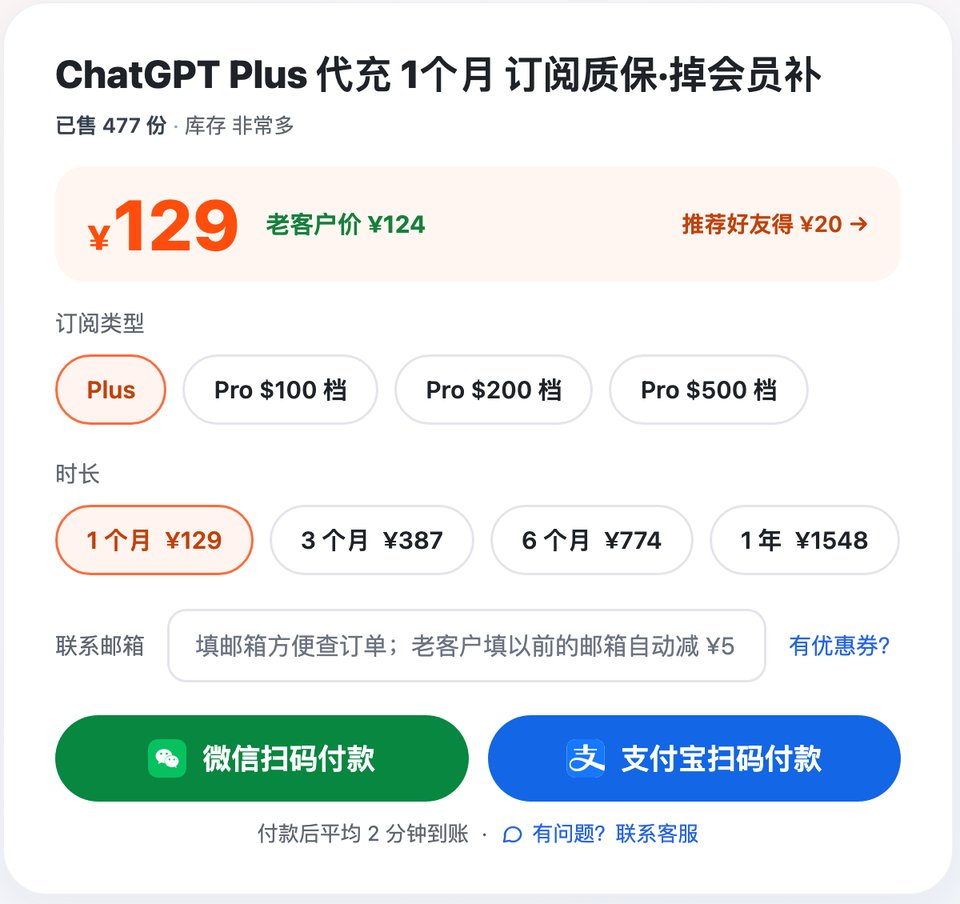
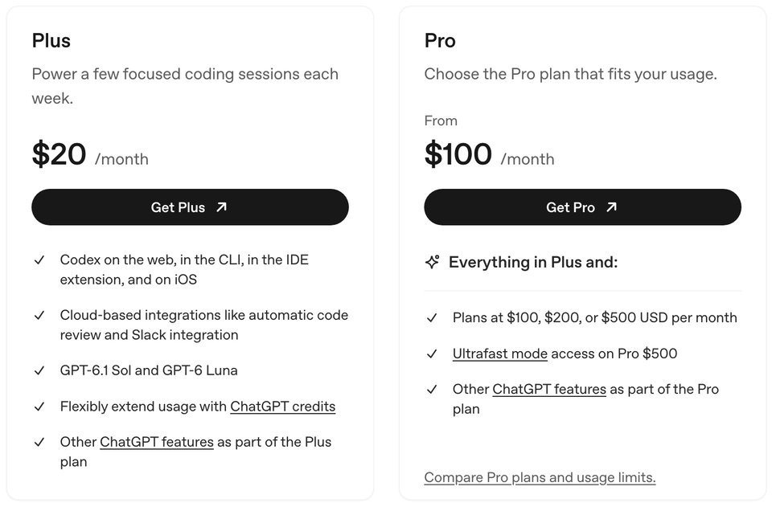
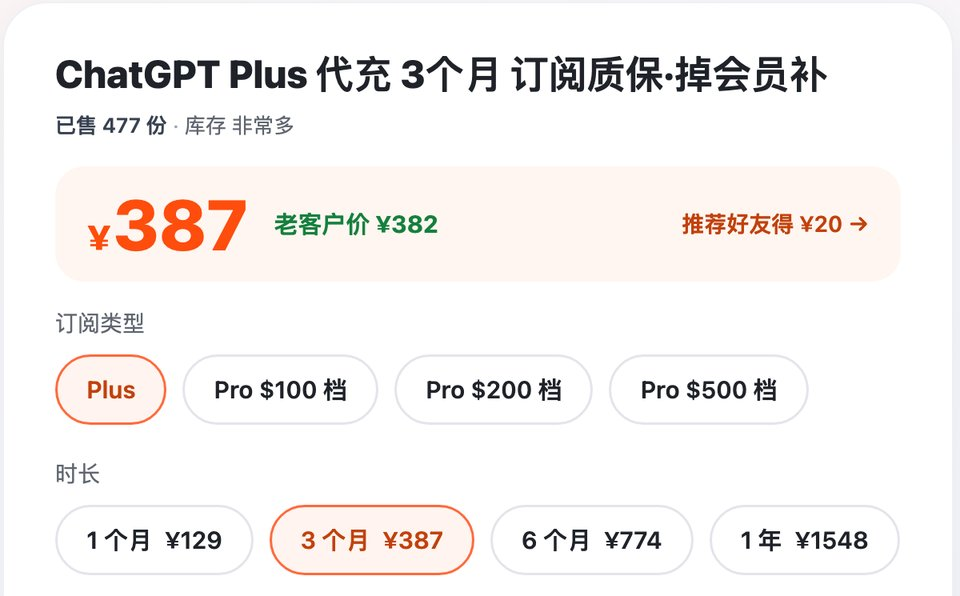

# ChatGPT Plus购买指南 2026：GPT会员有什么、怎么订阅、买几个月

> 2026-10-30 更新 · 瑶瑶ai训练师（kw.yaoyao.chat 店主）整理 · 文中商城链接为广告

**先说结论：** 国内想要 Plus，到瑶瑶ai训练师的商城下单 [ChatGPT Plus购买 ¥129 一个月](https://kw.yaoyao.chat/item/5?utm_source=github&utm_medium=readme&utm_campaign=plus&utm_content=top) 就行，会员开在你原来的账号上，聊天记录都在。支付宝、微信付，用不着交密码，平均 2 分钟开好；没开成退钱，本期内掉会员补一个月。瑶瑶这边近 30 天全渠道开通了 402 单。下单填券码 **888888** 再减 ¥3。

- **买到什么**：ChatGPT会员（Plus）有 GPT-6 的 Medium、High 思考档，增强版深度研究，全平台的 Codex，没有广告。
- **官方怎么收**：每月 20 美元，只能月付，官网收信用卡、借记卡和部分国家的本地支付，没有支付宝和微信。
- **买几个月**：头一回买 1 个月。3 个月、6 个月是一单 3 / 6 张卡密，每张 1 个月；1 年一次开满。都是 ¥129 乘月数，不打折。
- **谁不用买**：一周只开两三次、只翻译几句话的，免费版够用；有能在官网付款的卡、人也在支持地区的，直接官网订更省事。

*图：瑶瑶商城 Plus 下单区（kw.yaoyao.chat/item/5，2026-10-30 截图）*

## gptplus订阅包含什么

Plus 到底给了什么，OpenAI 拆在三个地方写：chatgpt.com 的定价页、帮助中心、Codex 定价页。2026-10-30 三处逐条对过一遍，跟普通用户沾边的归成一张表：

| 项目 | Plus 包含的内容 | 出自哪里（2026-10-30 核对） |
|---|---|---|
| 价格 | 每月 20 美元，按月扣；帮助中心写明眼下不支持年付，也不能一次预付几个月 | 帮助中心 Plus 介绍 |
| 聊天里的 GPT-6 | Instant、Medium、High 三档，背后是 GPT-6 Sol；Extra High 和 Pro 思考档不在 Plus 里；GPT-5.6 Sol 也能单独选 | 帮助中心·聊天模型 |
| 能塞多少内容 | 推理模型总上下文 256K，一次大约能放进 320 页文字；Instant 是 54K，约 40 页 | 中文定价页比较表 |
| 工具 | 增强版深度研究、带思考过程的出图、交互式表格和图表、站点（Sites）、计划任务、自定义 GPT、开发者模式（测试版） | 中文定价页 |
| ChatGPT 工作和 Codex | 工作模式桌面、网页、手机都能开；Codex 有网页、命令行、IDE 插件、iOS 四个入口，带自动代码审查和 Slack 集成；两边共用一份额度 | Codex 定价页、中文定价页 |
| 高峰期 | 人多时优先排队，回得也快 | 帮助中心 Plus 介绍 |
| 额度见底 | 另买 ChatGPT credits 接着用，不用为此升档 | Codex 定价页 |
| 广告 | 没有。帮助中心写明广告只投给免费版和 Go | 帮助中心·广告 |
| 不包含 | API 用量另外计费；每月送的 API 额度只有 Pro 才有 | 帮助中心 Plus 介绍、中文定价页 |

官方自己也提醒，模型和额度会跟着推送变，最后以你账号里模型菜单显示的为准。

*图：OpenAI 官方定价页截图，左边 Plus 每月 20 美元，右边 Pro 100 美元起（learn.chatgpt.com/docs/pricing，2026-10-30）*

## gpt会员各档对比：免费版、Go、Plus、Pro

很多人分不清 Go 和 Plus。把中文定价页底下那张长长的比较表摘出跟日常使用有关的几行（2026-10-30 核对，月费取自 Codex 定价页）：

| 对比项 | 免费版 | Go | Plus | Pro |
|---|---|---|---|---|
| 官方月费 | 0 | 8 美元 | 20 美元 | 100 / 200 / 500 美元 |
| 聊天思考档 | 只有 Think | 只有 Think | Medium、High | 再加 Extra High 和 Pro |
| GPT-6 系列 | 只有 Luna | 只有 Luna | 有限使用 | 扩展用量 |
| Instant 一次能读 | 约 12 页 | 约 40 页 | 约 40 页 | 约 250 页 |
| 推理上下文 | 不定 | 256K | 256K | 400K |
| 深度研究 | 有限 | 有限 | 增强版 | 最高用量 |
| ChatGPT 工作 | 桌面端，受限 | 桌面端，受限 | 桌面、网页、手机 | 同 Plus，会话更长 |
| Codex | 有限 | 有限 | 有，按 5 小时估算 | 扩展，眼下没有 5 小时限制 |
| 站点、开发者模式、交互式图表 | 没有 | 没有 | 有 | 有 |
| 带思考过程的出图 | 没有 | 没有 | 有 | 有 |
| 抢先试新功能 | 没有 | 没有 | 有 | 有 |
| 广告 | 可能有 | 可能有 | 没有 | 没有 |
| 每月 API 额度 | 没有 | 没有 | 没有 | 有，条件见官方 |

这张表里藏着两条分界线。免费版升 Go，多出来的是次数：上传、出图、语音、记忆都给得更宽，可思考档和完整的深度研究还锁着。Go 升 Plus，才把 Medium、High 思考档、完整的深度研究、全平台的工作模式和 Codex 一起打开。再往上到 Pro，会多出 dot、Extra High 和 Pro 思考档这些，但大头是用量和速度。

所以说白了：只聊天、翻译、偶尔传个文件，Go 就够；要让它多想几步、写代码、做研究，Plus 才是起点。Pro 三档怎么挑，这篇不展开。

## Plus 的 Codex 能干多少活：每 5 小时估算表

Codex 定价页给 Plus 的定位很直白，叫"每周跑几次专注的编程"。额度没给死数，只给了每 5 小时能发多少条本地消息的范围。下面把官方模型说明里每个模型的定位也并进来（2026-10-30 核对）：

| 模型 | 官方怎么定位 | Plus 每 5 小时（估算） |
|---|---|---|
| GPT-6 Astra | 能力最强，啃最难的代码和研究 | 5～45 条 |
| GPT-6.1 Sol | 接近 Astra、更省，适合反复跑的长任务 | 15～160 条 |
| GPT-6.1 Terra | 快，擅长写作、看图表、操作电脑 | 35～285 条 |
| GPT-6 Sol | GPT-6.1 Sol 的上一版 | 15～150 条 |
| GPT-6 Luna | 最省，做摘要、提取、小范围改代码 | 350～3,000 条 |

拿这张表判断 Plus 够不够，记住四点：

- **差距在模型上**。同样 5 小时，全程开 Astra 跑大任务，少的时候五条左右就见底；小改动交给 Luna，几百条打底。别默认开最强的那个。
- **范围是估算，不是封顶**。任务越大、越多丢到云端跑，耗得越快；5 小时之外，官方说还可能有每周限制。
- **见底了不用急着升档**。等它重置、换个小模型，或者买 credits 接着干，三条路都行。
- **真不够的信号**：一周好几天在写到一半时撞顶，每天整天让 Codex 改代码。到这一步，Plus 撑不住，再去看 Pro。

## Plus 这个月多了什么（2026 年 10 月）

网上不少 Plus 介绍还停在 9 月以前的样子。照 ChatGPT 发布说明和 Codex 定价页（2026-10-30 核对），10 月跟 Plus 有关的变化是这些：

| 日期 | 跟 Plus 有关的变化 |
|---|---|
| 10-06 | 付费订阅可以上传音频，转文字、总结录音 |
| 10-07 | GPT-6 进聊天，Plus 第一批拿到，用的是 GPT-6 Sol |
| 10-14 | GPT-5.5 退出 Codex（ChatGPT 登录方式），官方让 Plus 改用 GPT-6.1 Sol |
| 10-15 | Plus、Pro 建站点不再限个数，用量和存储限制照旧 |
| 10-20 | 锁定聊天开始推送，用 4 位 PIN 把选中的对话藏起来 |
| 10-26 | GPT-6.1 Terra 进工作模式和 Codex，Plus 在名单里，套餐总额度不变 |
| 10-29 | 只给 Pro 和 Business Premium 加了工作模式、Codex 额度，Plus 不在这次调整里 |

这一个月功能加了不少，Plus 的月费一直是 20 美元。

## chatgpt订阅值不值：看三个信号

很多人纠结半天，其实看三个信号就够：

1. **一天被限两三回**。免费版一提示上限，就切到弱一点的模型，要等几个小时才恢复。一周碰一两次还能忍；天天碰，说明你的用量已经到付费档的水平了。
2. **想用的东西上了锁**。Medium、High 思考档用不了，深度研究用几次就没了。
3. **手上的活很长**。几十页的 PDF、来回几十轮的对话，免费版常常是文件传不上，或者聊到一半就被限。

三条里占两条，就值得买。只占一条的，先测一周：照常用免费版，每被限一次、每碰到一个灰掉的功能，就在备忘录里记一笔。七天下来不到 3 次，接着用免费版；3 到 10 次，买一个月试试；一天好几次，直接买。

这几类人一般不用花这个钱：一周只打开两三次；只拿来翻译几句话、问点常识；只是这两天好奇，想看看新模型长什么样。

## gpt订阅买几个月：1 个月、3 / 6 个月还是 1 年

先说官方：Plus 只按月收。所以市面上叫"Plus 年卡""季卡"的，都是卖家自己的套餐，不是 OpenAI 的产品。

瑶瑶店里的四个时长在同一个下单页里选：

| 时长 | 价格 | 怎么开通 | 适合谁 |
|---|---|---|---|
| 1 个月 | ¥129 | 付款拿卡密，自己到 cz.yaoyao.chat 提交 | 第一次买；以后可能换 Pro |
| 3 个月 | ¥387 | 一单 3 张卡密，每张开 1 个月：先充第 1 张，到期再充下一张 | 确定长用，又想自己掌握节奏 |
| 6 个月 | ¥774 | 一单 6 张卡密，用法同上 | 工作离不开，不想一次付一年 |
| 1 年 | ¥1,548 | 付款后到订单页填一次登录信息，12 个月一次开好 | 全年天天用、老忘记续 |

*图：同一个下单页切到 3 个月（kw.yaoyao.chat/item/5?d=3，2026-10-30 截图），老客户价也只少 ¥5*

四档都是 ¥129 乘月数，长档没有额外便宜。3 / 6 个月和 1 年真正的区别在用法上：

- **卡密能先放着**。3 / 6 个月发的是长期有效的卡密，哪个月出差、放假用不上，那个月不充，回来再接着充。1 年那档是 12 个月连着走，用不用都在计时。
- **提前交没用**。上一张还没到期就交下一张，充值页会提示"已有订阅"，卡密不扣，等到期后再交。
- **1 年压在一个号上**。12 个月一次开进同一个账号。封号不在质保范围、不退款（ChatGPT 封号可以协助重新注册一个号），已经开通的月份也退不了。
- **价格当场锁定**。以后不管官方还是商城调价，涨了不用补，跌了也不退差价。
- **老客户按月买最省**。老客户每单减 ¥5，填以前买过的邮箱就行；一次买几个月只算一单，只减一次。

对号入座：

| 你的情况 | 建议 |
|---|---|
| 第一次买，或者说不准下个月还用不用 | 1 个月 |
| 过一阵可能升 Pro | 按月买 |
| 确定长用，但中间可能空几个月 | 3 个月或 6 个月 |
| 全年天天用，怕忘了续 | 1 年 |
| 号不太稳：多地登录过、跟别人共用过 | 只买 1 个月 |
| 每个月都回购、不嫌麻烦的老客户 | 按月买，每单减 ¥5 |

想好了长用，3 个月选 [gpt订阅 3 个月 ¥387](https://kw.yaoyao.chat/item/5?d=3&utm_source=github&utm_medium=readme&utm_campaign=plus&utm_content=mid-3m)，全年离不开的选 [ChatGPT会员 1 年 ¥1,548](https://kw.yaoyao.chat/item/5?d=12&utm_source=github&utm_medium=readme&utm_campaign=plus&utm_content=mid-year)，6 个月在同一个下单页里切。

买了长档，订阅页上每期只显示当月的到期日，状态还写着"已取消"。代充不绑你的付款方式，官方页面看它就是一份不会自动续的订阅，这是正常现象。

## chatgpt购买：官方入口和国内走法

说是 chatgpt购买，其实就是 chatgpt升级：在你现在这个账号上换套餐，不用注册新号，聊天记录、记忆、自定义设置都还在。手机和电脑登的是同一个会员，不用分开买。

**官方入口**：网页上点头像，选 Upgrade Plan，再点 Get Plus；iPhone 上点对话顶部的 Upgrade，扣款由 Apple 处理。国内用户多半卡在两处：官网收的是信用卡、借记卡和部分国家的本地支付，没有支付宝和微信，国内发的卡常被拒；中国大陆、香港、澳门也不在 OpenAI 的支持地区名单上（2026-10-26 核对）。

**国内常见的走法**：

1. 先在网页的"设置 → 订阅"里看一眼，确认现在是免费版，也不在 Business 工作区里。还挂着没到期的 Plus 或 Pro，提交会弹"已有订阅"，这回不扣钱，卡密留着下次用。
2. 到商城下单 Plus，支付宝或微信付，拿到卡密。
3. 用系统自带的浏览器登录 chatgpt.com，打开 chatgpt.com/api/auth/session，把整段登录信息复制下来，到 cz.yaoyao.chat 填卡密、贴登录信息，看清页面认出来的邮箱再提交。别在微信里点开去复制，经常复制不全。复制完马上交：瑶瑶店里开通失败最常见的原因，就是登录信息放太久过期了，开个无痕窗口重新登录再复制就行。
4. 平均 2 分钟到账，刷新后订阅页写着 ChatGPT Plus 就成了。最后去"设置 → 安全"把所有设备都登出，刚才那段登录信息就作废了。

规则是固定的：没开成，卡密不扣，重提或退款都行；开成后本期内会员掉了，同一个号补一个月；封号不保。有问题找瑶瑶本人的企业微信 `kw.yaoyao.chat/wecom`，24 小时在。

合租和成品号，劝你别碰。合租是几个人挤一个号，额度互相抢、聊天记录互相看得见，也违反官方条款；成品号的账号压根不归你，随时可能被原主找回或者被封。

按 2026-10-30 的统计，瑶瑶这边近 30 天全渠道开通 402 单（商城只是其中一个渠道）。瑶瑶ai训练师 2023 年 10 月开始做 AI 科普，全网约 320 万粉丝，各平台截图挂在 `kw.yaoyao.chat/guide/guanyu-yaoyao.html`，可以自己去对。

## 常见问题

**在网上搜"chatgpt购买"，买到的到底是什么？**
买的是开在你自己账号上的会员，就在原来的号上升级，聊天记录都在。个人能买的付费档有 Go、Plus、Pro 三种，大多数人说的"买 ChatGPT"就是 Plus：官方每月 20 美元，瑶瑶店里 ¥129 一个月。

**gptplus订阅和 openai订阅是一回事吗？**
是一回事，都指 ChatGPT 的付费订阅，最常见的是 Plus。OpenAI 另外还有按用量收费的 API，那个不算订阅，开了 Plus 也不含 API 额度。

**chatgpt会员购买要准备什么？**
一个能正常登录的 ChatGPT 账号（现在是免费版、不在 Business 工作区里），再加支付宝或微信。不用银行卡，也不用交密码和验证码。

**gpt订阅能用支付宝付吗？**
官网不行。官方收信用卡、借记卡，另有部分国家的本地支付（比如印度 UPI、韩国 Kakao Pay、菲律宾 GCash），名单里没有支付宝和微信（帮助中心 Multi-currency billing，2026-10-30 核对）。想用支付宝或微信，只能通过代充卖家，钱是付给卖家的。

**gpt plus购买以后多久能用上？**
卡密自己提交，平均 2 分钟到账；1 年那档是付款后去订单页填一次信息，同样平均 2 分钟搞定。

**Plus 的额度用完了怎么办？**
聊天里思考档到顶，ChatGPT 可能换个能用的模型接着回，能看到什么时候重置；官方客服没法帮你提前重置。Codex 那边可以等重置，或者买 credits 接着用。

**chatgpt订阅会自动续费吗？**
官网和应用商店的订阅会自动续，可以随时取消，用到这一期结束。代充开的不绑你的付款方式，到期不会扣钱。

**公司买 gpt会员能开发票吗？**
能。瑶瑶店里可开发票，也可以对公转账：下单后把订单号和抬头发到瑶瑶企业微信，票种开票前确认。

想好了，就去 [gpt会员购买（Plus 1 个月 ¥129）](https://kw.yaoyao.chat/item/5?utm_source=github&utm_medium=readme&utm_campaign=plus&utm_content=end) 下单；券码 **888888** 结账时照样能减 ¥3，全店通用，只是不和推荐码、老客户减 ¥5 一起用。

## 相关教程

- [ChatGPT充值教程](https://github.com/yaoyao-chat/chongzhi)：拿到卡密后在充值页怎么填，提示报错怎么处理
- [瑶瑶ai训练师教程合集](https://github.com/yaoyao-chat/yaoyao-chat.github.io)：Pro、Codex、Claude、Grok 等会员的教程目录

## 核对与来源

商城价格、售后、开票和近 30 天开通量照商城事实卡写（2026-10-30 03:59 导出）；3 个月、6 个月的用法照商城发货原文（一单 3 / 6 张卡密、每张 1 个月、到期充下一张、卡密长期有效）。官方部分除特别注明的日期外，都是 2026-10-30 当天打开页面逐条对的。

- Codex 定价页 [learn.chatgpt.com/docs/pricing](https://learn.chatgpt.com/docs/pricing)：免费版 0、Go 8 美元、Plus 20 美元、Pro 100 / 200 / 500 美元；Plus 卡片的定位和 Codex 内容；每 5 小时估算、可能有每周限制、Pro 眼下没有 5 小时限制；额度见底可买 credits；GPT-5.5 在 10-14 退出 Codex
- Codex 模型说明 [learn.chatgpt.com/docs/models](https://learn.chatgpt.com/docs/models)：Astra、GPT-6.1 Sol、GPT-6.1 Terra、Luna 各自的定位；GPT-5.5 下线后 Plus 改用 GPT-6.1 Sol
- ChatGPT 中文定价页 [chatgpt.com/zh-Hans-CN/pricing](https://chatgpt.com/zh-Hans-CN/pricing/)：四档套餐卡片和比较表（思考档、上下文、深度研究、工作模式、Codex、站点、出图、API 额度）；付款用主要信用卡；Go、Plus 只有月度套餐
- 帮助中心 [What is ChatGPT Plus?](https://help.openai.com/articles/6950777)：20 美元按月扣、不支持年付和预付多月、高峰优先、API 另计费、网页升级路径
- 帮助中心 [GPT-6 and other models in ChatGPT](https://help.openai.com/articles/20001354)：Plus 有 Medium、High，没有 Extra High 和 Pro 思考档；免费版和 Go 只有 Think；到顶后换模型继续
- 帮助中心 [Ads in ChatGPT](https://help.openai.com/articles/20001047)：广告只投免费版和 Go，Plus 没有广告
- 帮助中心 [ChatGPT release notes](https://help.openai.com/articles/6825453)：10-06 音频上传、10-07 GPT-6 进聊天、10-15 站点不限个数、10-20 锁定聊天、10-26 GPT-6.1 Terra、10-29 只调 Pro 和 Business Premium
- 帮助中心 [iPhone 上升级付费订阅](https://help.openai.com/articles/7905739)：入口在对话顶部，App Store 里买的由 Apple 管理
- [OpenAI 支持的国家和地区](https://platform.openai.com/docs/supported-countries)（2026-10-26）：中国大陆、香港、澳门不在名单
- [OpenAI 使用条款](https://openai.com/policies/terms-of-use/)（2026-10-20）：不得把账户凭据给别人
- 帮助中心 [Multi-currency billing](https://help.openai.com/en/articles/10421635-multicurrency-billing)：官网收信用卡、借记卡，部分国家另有本地支付（UPI、Kakao Pay、GCash 等），没有支付宝和微信（2026-10-30 核对）
- 帮助中心 [About ChatGPT Pro tiers](https://help.openai.com/en/articles/9793128-about-chatgpt-pro-tiers)：官方客服不能重置 ChatGPT 或 Codex 的额度（2026-10-30 核对）

## 关于作者与声明

写这篇的是瑶瑶ai训练师：2023 年 10 月开始做 AI 科普，各平台加起来约 320 万粉丝。内容是 kw.yaoyao.chat 店主一手整理的，文中指向商城的链接，都是瑶瑶自家店的广告。要说清楚的是，代充不是官方渠道，这家店跟 OpenAI 既无隶属、也无授权。不管谁来问，哪怕自称瑶瑶客服，密码和验证码都别给；真正的客服只在企业微信 `kw.yaoyao.chat/wecom`。
